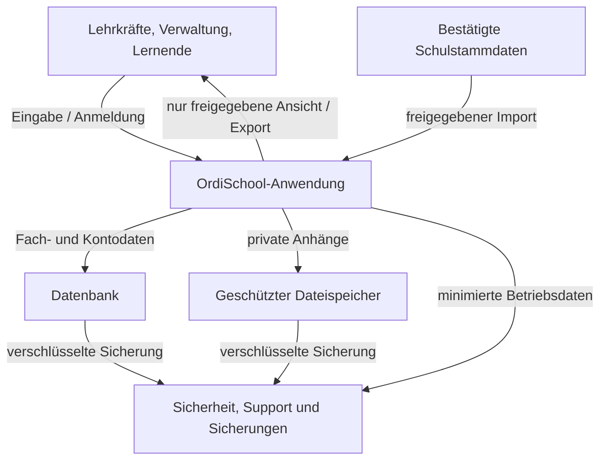

# Vorläufiger Datenfluss

**Version:** 0.0.4  
**Status:** logisches Zielbild; tatsächliche Architektur, Hostinganbieter, Speicherorte und Unterauftragnehmer sind offen.

## 1. Systemgrenze

Die Darstellung beschreibt Datenflüsse für eine mögliche von Schule oder Schulträger beauftragte OrdiSchool-Instanz. Ob Anbieter, Schule, Schulträger oder mehrere Stellen Verantwortliche bzw. Auftragsverarbeiter sind, muss aus den tatsächlichen Entscheidungen über Zwecke und Mittel bestimmt werden. Eine Vertragsbezeichnung allein entscheidet diese Rolle nicht.

**Lesart:** Der Dateispeicher und Sicherungsbereich sind logische Komponenten, keine bereits ausgewählten Anbieter. Personenbezogene Inhalte dürfen nicht in öffentlichen Datei-URLs oder frei zugänglichen Backups landen.

## 2. Datenfluss je Lebenszyklus

| Phase | Eingang / Aktion | Verarbeitung | Ausgabe / Empfänger | Kontrolle |
|---|---|---|---|---|
| Konto bereitstellen | Bestätigte Schulverwaltung legt Konto und Zuständigkeit an | Anmeldung und Rollen-/Scope-Zuordnung | eigener Zugang; autorisierte Kontoverwaltung | Quelle und Zuordnung prüfen; Konto minimal gestalten; Rollenwechsel zeitnah wirksam |
| Stammdaten importieren | freigegebener Export aus Schulverwaltung oder bestätigte manuelle Eingabe | Format-/Pflichtfeldprüfung, Dublettenprüfung, Zuordnung zur Schule und Gültigkeit | Klassen-, Fach- und Planungsansichten | Importprotokoll minimieren; unzulässige Zusatzfelder verwerfen; Datenqualität/Quelle sichtbar machen |
| Planen und veröffentlichen | Stunden-, Raum-, Personaleinsatz- und lokale Raumdaten | Konfliktprüfung, Vorschläge, menschliche Prüfung und Freigabe | freigegebener Plan an betroffene Lehrkräfte und Lernende | nur notwendige Angaben; Abwesenheitsgründe nicht breit verteilen; Vorschläge werden nicht automatisch veröffentlicht |
| Unterricht dokumentieren | Anwesenheit, Thema, Hausaufgabe, Vertretung und erforderliche Notiz | Planabgleich und Hinweisbildung | berechtigte Lehrkraft und ggf. begrenzte zuständige Schulrolle | keine automatische Inhaltskorrektur; Zugriff auf Notizen begrenzen; Warnhinweise nicht zu zusätzlichen Schülerprofilen ausbauen |
| Aufgaben/Kommunikation | Text, Empfänger, Termine und Dateien | Gruppen-/Empfängerrechte prüfen; Dateityp/-größe prüfen | nur zugewiesene Empfänger | Zugriffskontrolle auf jeder Datei; Vorschau über Zielgruppe; Push-/E-Mail-Inhalte minimieren |
| Bewerten/Zeugnis | bestätigte Leistungsdaten und freigegebene Verfahren | nachvollziehbare Berechnung, Entwurf, menschliche Prüfung | freigegebene Ergebnisse an jeweilige Lernende bzw. autorisierte Rollen | Verfahrensversion und Korrektur protokollieren; keine stillen rückwirkenden Änderungen |
| Betrieb/Support | Sicherheitsereignis oder Supportanfrage | technische Diagnose mit minimierten Logs | eng begrenztes technisches Personal bzw. Anbieter | Standard-Support sieht keine pädagogischen Inhalte; erforderlicher Notfallzugriff zeitlich begrenzt, genehmigt und protokolliert |
| Backup/Restore | Datenbank und private Dateien | verschlüsselte, getrennte Sicherung und getestete Wiederherstellung | Betriebspersonal nur zur Wiederherstellung | gleiche Schutzbedarfsstufe wie Quelle; Backup-Löschung und Restore-Inhalt auf Lösch-/Berichtigungswünsche abstimmen |
| Export/Übergabe/Löschung | dokumentierter Antrag oder Vertrags-/Schulende | Scope und Berechtigung prüfen, Export bereitstellen oder Daten nach Plan löschen/archivieren | nur bestätigte Stelle bzw. betroffene Person, soweit rechtlich vorgesehen | Zweck, Empfänger, Format, Zeitpunkt und Ergebnis protokollieren; Kopien in Unterauftragsverarbeitung und Backups behandeln |

## 3. Externe Stellen und Schnittstellen

| Dienst / Empfängerart | Geplanter Status | Vor Freigabe nachzuweisen |
|---|---|---|
| Hosting, Datenbank und Dateispeicher | Anbieter noch nicht ausgewählt | Verantwortlichkeits-/AV-Rolle, Standort, Zugriff, TOMs, Unterauftragsverarbeiter, Löschung, Rückgabe, Audit-/Nachweisrechte und Ausfallsicherheit |
| Mail-/Push-Zustellung | deaktiviert bzw. nicht festgelegt | Empfänger, Inhalt/Metadaten, Speicherzeit, Unterauftragnehmer und Drittlandbezug; keine sensiblen Inhalte in Vorschautexten |
| Monitoring, Fehleranalyse und Support | noch nicht festgelegt | konkrete Logs, Identifizierbarkeit, Zugriff, Aufbewahrung und Supportland; Schülertexte/Noten aus Fehlertelemetrie ausschließen |
| KI-/Optimierungsdienste | keine Übermittlung personenbezogener Daten als Standard | falls später vorgesehen: Anbieterrolle, Zweck, Rechtsgrundlage, Datenumfang, Speicher-/Trainingsnutzung, Drittlandtransfer, DSFA und schulische Freigabe |
| Andere Schul-/Fachverfahren | keine Schnittstelle beschlossen | Datenfeldmapping, Zweck und Empfänger, Übermittlungsbefugnis, Protokoll, Fehlerkorrektur, Rechts-/Vertragsprüfung |

## 4. Datenfluss- und Zweckänderungsregeln

- Jede Schnittstelle ist standardmäßig aus und erhält eine eigene Datenflussbeschreibung.
- Importfelder werden auf eine freigegebene Positivliste begrenzt. Nicht zugeordnete Spalten werden nicht still importiert.
- Ein Empfängerzugriff wird serverseitig geprüft; ein gültiger Link oder ein verstecktes UI-Element genügt nicht.
- Personenbezogene Daten werden nicht für Produktanalysen, Werbung, Modelltraining oder allgemeine Demonstrationen weiterverwendet.
- Produkttelemetrie wird von Fachinhalten getrennt. Fehlerberichte dürfen nicht unbemerkt vollständige Nachrichten, Noten oder Anwesenheitsnotizen enthalten.
- Zweck-, Empfänger-, Speicherort- oder Funktionsänderungen aktualisieren Dateninventar, VVT-Unterlagen und bei Bedarf die DSFA-Bewertung vor der Aktivierung.
- Exportformate bleiben kontrolliert, zweckgebunden, protokolliert und nur für autorisierte Rollen verfügbar.
